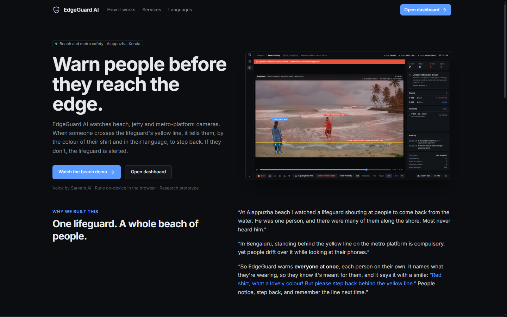
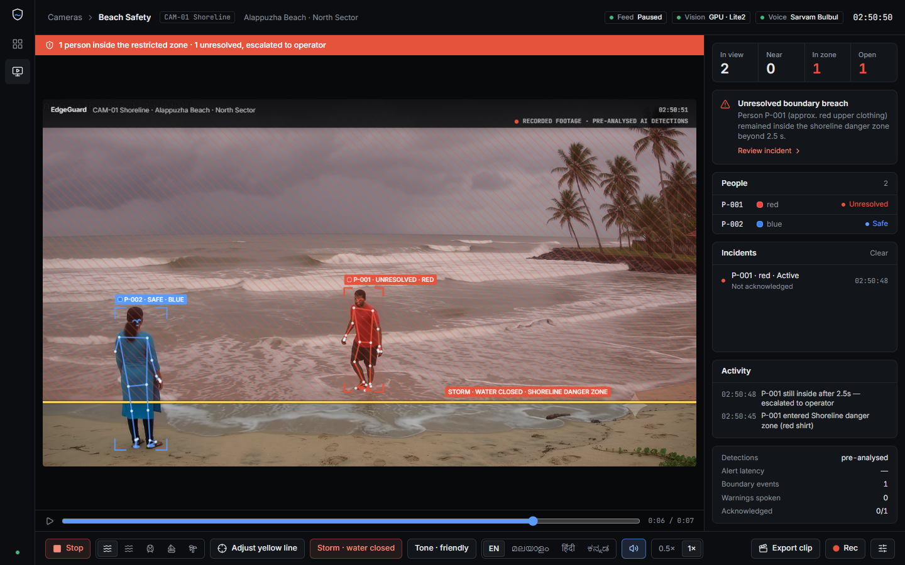
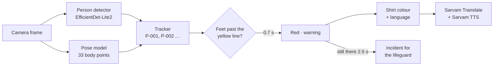
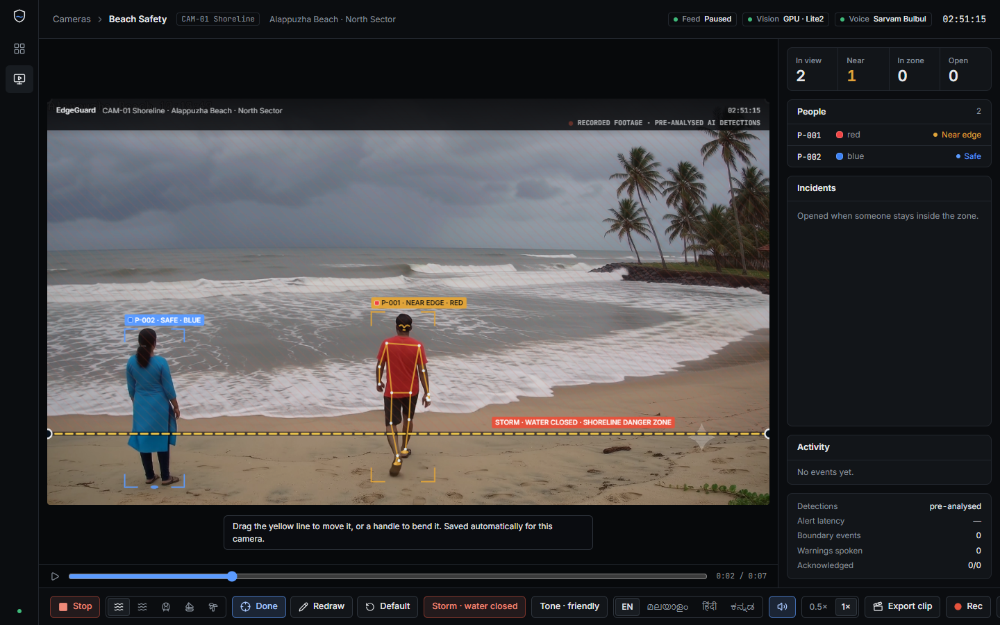
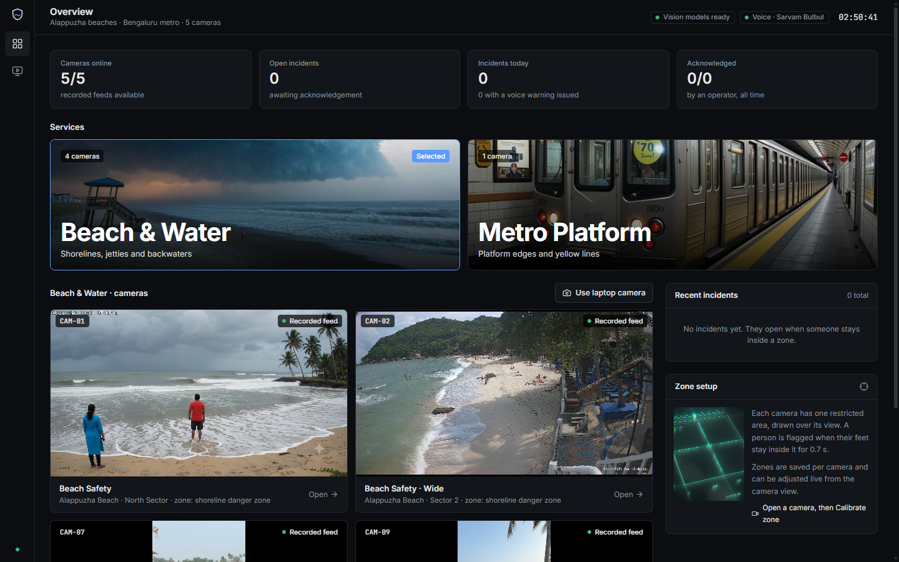
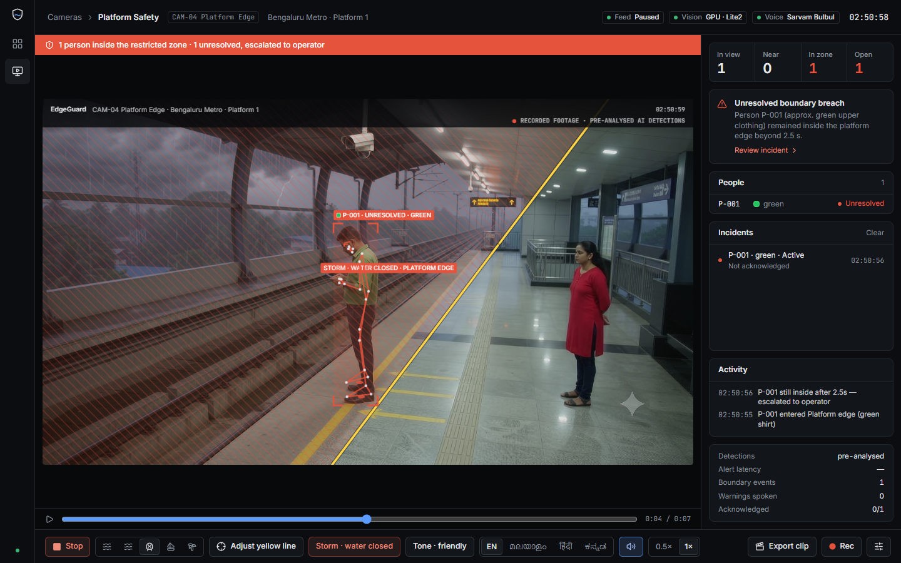
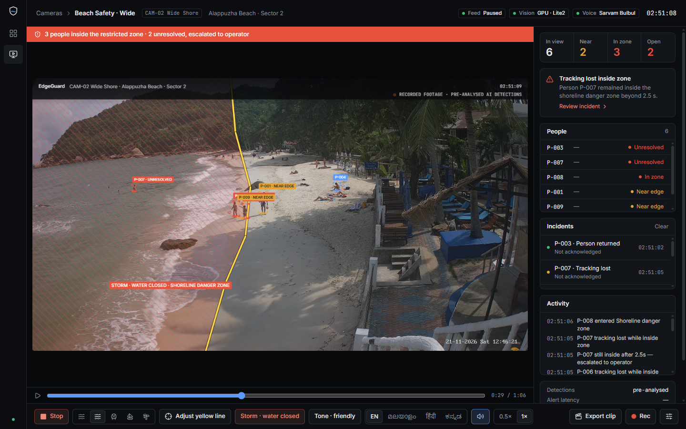
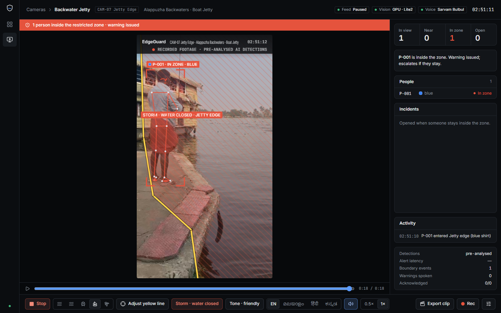
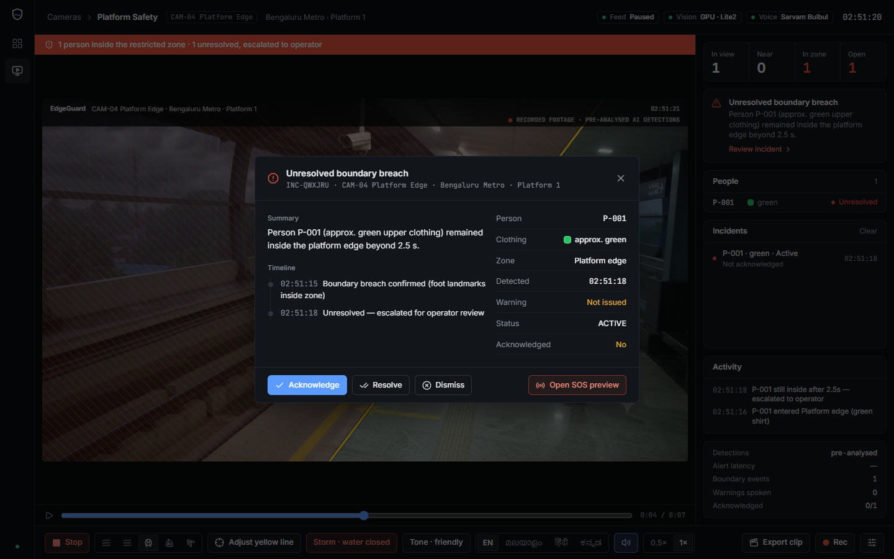

# EdgeGuard AI

**Warn people before they reach the edge.**

EdgeGuard AI watches beach, jetty and metro-platform cameras. When someone crosses the lifeguard's yellow line, it warns that person out loud:
- **names what they're wearing**, so they know the warning is meant for them
- **speaks their language**: English, Malayalam, Hindi or Kannada, voiced by **Sarvam AI**
- **alerts the lifeguard** if they don't step back

Built at **HackaThoni 2026, Alappuzha** · Beyond the Screen track · Voice by **Sarvam AI**



---

## The story

### 1. One lifeguard, a whole beach
> "I visited Alappuzha, and near the beach I saw the lifeguard telling people to go back from the water. But he was only one person, and there were many people on that side. He whistled and shouted, and most of them never even heard him."

That's the problem EdgeGuard solves. A camera can watch the whole shoreline at once, so **every person who crosses the line gets their own warning, at the same moment**. Nobody is missed because the lifeguard was looking the other way.

### 2. The yellow line in Bengaluru
> "In Bengaluru, standing behind the yellow line on the metro platform is compulsory. But people still step over it while looking at their phones, and a general announcement, 'Passengers, please stand behind the yellow line', is easy to ignore because it isn't meant for anyone in particular."

### 3. Say what they're wearing, and make it fun
> "So I made sure EdgeGuard says the person's attire. When you hear 'Red shirt!', you know it's you. It's more fun, people smile, they step back, and they're more attentive next time."

My first idea was to call people "hey, beautiful lady", "pretty girl" or "handsome guy" to make them come back from the yellow line. We turned that into the **friendly tone**, which compliments the outfit rather than the person:

> "Red shirt, what a lovely colour! But the sea is closed today. Please step back behind the yellow line."

We made this choice for two reasons:
- The camera can't reliably tell someone's gender, and calling a man "lady" on a loudspeaker would embarrass him in front of a crowd.
- Comments on looks from a public speaker can feel uncomfortable.

The outfit compliment gets the same smile and the same attention, in all four languages. A **formal tone** is one click away for authorities who prefer it.

### 4. In their own language
Alappuzha gets visitors from all over India, and Bengaluru's metro is just as mixed. So the same warning can be spoken in **English, Malayalam, Hindi or Kannada**, voiced by **Sarvam AI**.

---

## What it does

| Step | What happens |
|---|---|
| **1. See** | On-device AI finds every person in the frame, with their body pose and feet. |
| **2. Check** | Each person's feet are tested against the **yellow safety line** the lifeguard has set. |
| **3. Warn** | Crossing the line turns that person **red** after 0.7 s, and they hear a warning that names their shirt colour. |
| **4. Escalate** | If they stay, an **incident** opens for the lifeguard to acknowledge, resolve, or open a simulated SOS preview. |



*The man in the **red** shirt has walked into the water during a storm warning: red overlay, "unresolved" status, an incident for the lifeguard. The woman in **blue** stays on the sand and is marked safe.*

---

## What EdgeGuard says

These are the exact sentences, taken from the generated Sarvam recordings that ship with the app.

**Friendly tone** (default). It compliments the outfit to grab attention, and addresses the shirt rather than the person, so no language has to guess anyone's gender.

| Where | Language | Spoken warning |
|---|---|---|
| Beach, storm | English | "Red shirt, what a lovely colour! But the sea is closed today. Please step back behind the yellow line." |
| Beach, storm | Malayalam | "ഹലോ സുഹൃത്തേ, ചുവന്ന ഷർട്ട് നന്നായിട്ടുണ്ട്! പക്ഷേ ഇന്ന് കടൽ അടച്ചിരിക്കുകയാണ്. ദയവായി മഞ്ഞ വരയ്ക്ക് പിന്നിലേക്ക് മാറൂ." |
| Beach, storm | Hindi | "लाल कमीज़, क्या प्यारा रंग है! लेकिन आज समुद्र बंद है। कृपया पीली रेखा के पीछे हट जाइए।" |
| Beach, storm | Kannada | "ಕೆಂಪು ಅಂಗಿ, ಎಂತಹ ಸುಂದರ ಬಣ್ಣ! ಆದರೆ ಇಂದು ಸಮುದ್ರ ಮುಚ್ಚಲ್ಪಟ್ಟಿದೆ. ದಯವಿಟ್ಟು ಹಳದಿ ಗೆರೆಯ ಹಿಂದೆ ಸರಿಯಿರಿ." |
| Metro platform | English | "Green shirt, what a great colour! But please step back behind the yellow line." |

**Formal tone** (one click). Plain public-address wording.

| Where | Language | Spoken warning |
|---|---|---|
| Beach, storm | English | "Attention please, you in the red shirt. Storm warning: the sea is closed. Please step back behind the yellow line." |
| Beach, storm | Malayalam | "ശ്രദ്ധിക്കുക, ചുവന്ന ഷർട്ട് ധരിച്ച വ്യക്തി. കൊടുങ്കാറ്റ് മുന്നറിയിപ്പ്: കടലിൽ ഇറങ്ങുന്നത് നിരോധിച്ചിരിക്കുന്നു. ദയവായി മഞ്ഞ വരയ്ക്ക് പിന്നിലേക്ക് മാറുക." |
| Beach, storm | Hindi | "कृपया ध्यान दें, आप लाल शर्ट में हैं। तूफान की चेतावनी: समुद्र बंद है। कृपया पीली रेखा के पीछे हट जाएं।" |
| Beach, storm | Kannada | "ದಯವಿಟ್ಟು ಗಮನಿಸಿ, ಕೆಂಪು ಅಂಗಿ ಧರಿಸಿರುವ ನೀವು. ಬಿರುಗಾಳಿಯ ಎಚ್ಚರಿಕೆ: ಸಮುದ್ರವು ಮುಚ್ಚಲ್ಪಟ್ಟಿದೆ. ದಯವಿಟ್ಟು ಹಳದಿ ಗೆರೆಯ ಹಿಂದೆ ಸರಿಯಿರಿ." |

If the colour can't be read reliably (poor light, mixed colours), EdgeGuard does not guess. It uses a general line instead, for example "Hello there! The sea is closed today. Please step back behind the yellow line."
When several people cross at once, it makes a single announcement, for example "Hello everyone! …", instead of talking over itself.

---

## How the code helps

| The real-world problem | What EdgeGuard does | Where in the code |
|---|---|---|
| One lifeguard can't watch or shout at dozens of people | Every person gets a temporary ID and their own state, and many are tracked at once | `src/lib/tracker.ts`, `src/lib/safety.ts` |
| People ignore a generic "please step back" | The warning names the shirt colour, sampled from the torso and confirmed over several frames | `src/lib/color.ts`, `src/lib/presets.ts` |
| Visitors speak different languages | English and Malayalam are hand-written; Hindi and Kannada come from **Sarvam Translate**; all four are voiced by **Sarvam Bulbul** | `server/tts-proxy.ts`, `api/tts.ts`, `src/lib/voice.ts` |
| Every beach and platform is different | The lifeguard drags the **yellow line** onto the live video, and it's saved per camera | `src/components/Stage.tsx`, `src/lib/zones.ts` |
| A ban only applies in bad weather | **Storm mode**: water closed, so crossing is red and triggers a warning. **Normal mode**: the line is advisory, amber only. | `src/lib/monitor.ts` |
| False alarms waste a lifeguard's attention | 0.7 s confirmation before red, 2.5 s before escalation, weak detections kept only if the pose model agrees | `src/lib/safety.ts`, `public/vision-worker.js` |
| Demos and venues have slow laptops and bad Wi-Fi | Detections and all 288 voice clips ship as files: clips open in under 1 s and voices play offline | `public/analysis/`, `public/voice/`, `scripts/` |
| Privacy | No face recognition, no identity, no video stored. Losing sight of someone is reported as "tracking lost", never as drowning | the whole pipeline runs in the browser |

### Pipeline



---

## For the lifeguard



| Control | What it does |
|---|---|
| **Adjust yellow line** | Drag the line anywhere to slide it, or drag a handle to bend it. Saved per camera. |
| **Storm · water closed / Normal · advisory** | Storm: crossing means red, voice warning and an incident. Normal: amber only, no alarm. |
| **Tone · friendly / formal** | Choose the playful compliment or the plain announcement. |
| **EN · മലയാളം · हिंदी · ಕನ್ನಡ** | Warning language (`L` cycles through them). |
| **Incident → Acknowledge / Resolve / SOS preview** | The lifeguard decides. The SOS preview is a simulation: nothing is ever sent. |

Keyboard: `Space` pause · `C` adjust line · `L` language · `M` mute · `Esc` close.

---

## Screenshots

| Overview: services and cameras | Metro platform |
|---|---|
|  |  |
| **Wide beach camera** | **Backwater jetty (real footage)** |
|  |  |
| **Incident review and SOS preview** | |
|  | |

---

## Try it

**Live demo:** _add your Vercel URL here_

**Run locally** (Chrome or Edge):
```powershell
npm install
npm run dev
```
Open http://localhost:5173, then **Open dashboard** and pick a camera.

**Sarvam key.** Copy `.env.example` to `.env` and set `SARVAM_API_KEY`. The key stays on the server (`server/tts-proxy.ts` locally, `api/tts.ts` on Vercel) and never reaches the browser. Without a key, the shipped voice pack still plays every warning.

**Deploy to Vercel.** Import the repo on vercel.com, add `SARVAM_API_KEY` under Environment Variables, and deploy. The settings come from `vercel.json`.

**Demo links** (open a camera at a set moment):
- `/?camera=beach&t=6.6`: the man in red, unresolved in the water
- `/?camera=metro&t=4.2&lang=hi`: the metro platform with Hindi warnings
- `/?camera=beach&edit=1`: the yellow-line editor

### Two-minute judge demo
1. Open the landing page, then **Open dashboard**: two services, five cameras.
2. Open **Beach Safety**. The man in red walks into the sea, turns red, and hears the friendly storm warning. He walks back and it shows **cleared**.
3. Switch the language to **മലയാളം**, **हिंदी** or **ಕನ್ನಡ** and play it again.
4. **Adjust yellow line**: drag it live to show that the lifeguard sets the border.
5. Toggle **Normal · advisory**: crossing now only shows amber.
6. Open the incident, **Acknowledge** it, and open the **SOS preview**.
7. **Metro Platform**: the same engine with the yellow-line warning.

---

## Repository guide

```
EdgeGuard AI
├── src/                     the app (React + TypeScript)
│   ├── components/          Landing, Overview, camera console, panels, incident dialog
│   ├── lib/
│   │   ├── monitor.ts       runs a camera: feed → AI → tracking → line check → voice → incidents
│   │   ├── tracker.ts       gives each person a temporary ID across frames
│   │   ├── safety.ts        Safe → Near edge → In zone → Unresolved → Cleared
│   │   ├── color.ts         shirt colour from the torso (says "unknown" rather than guess)
│   │   ├── presets.ts       cameras, default yellow lines, warning sentences
│   │   ├── voice.ts         plays warnings: shipped pack first, live Sarvam second
│   │   └── render.ts        draws skeletons, labels and the yellow line on the video
│   └── types.ts
├── public/
│   ├── vision-worker.js     AI inference (MediaPipe) off the main thread
│   ├── videos/              demo footage
│   ├── analysis/            pre-computed detections for each clip (instant start)
│   ├── voice/               288 Sarvam voice clips + manifest (instant, offline)
│   └── media/               landing images
├── server/tts-proxy.ts      local Sarvam proxy (Translate + TTS), keeps the key server-side
├── api/tts.ts               the same proxy as a Vercel serverless function
├── scripts/                 model download, voice pack builder, screenshot capture
└── docs/                    screenshots and video-generation prompts
```

---

## Built with

- **Sarvam AI**: Bulbul v3 text-to-speech (English, Malayalam, Hindi, Kannada) and Sarvam Translate (`sarvam-translate:v1`) for the Hindi and Kannada warnings.
- **MediaPipe** (Google): EfficientDet-Lite2 person detector and Pose Landmarker, running in the browser.
- **React, TypeScript, Vite, Tailwind CSS**, Framer Motion, Lucide icons. Hosted on Vercel.

## AI tools declaration

As required by the hackathon rules, these are the AI tools used in this project:

| Tool | What it was used for |
|---|---|
| **Devin AI** (Cognition) | AI software-engineering assistant used while building the app: parts of the code and documentation. The concept, product decisions, testing and demo are the team's own. |
| **Sarvam AI** | Runs inside the product: **Bulbul v3 text-to-speech** speaks every warning in English, Malayalam, Hindi and Kannada, and **Sarvam Translate** (`sarvam-translate:v1`) produces the Hindi and Kannada warnings. |
| **Google Veo 3** | I generated the demo videos `beach.mp4` (storm beach) and `metro.mp4` (metro platform) with Veo 3, as staged re-enactments, so nobody had to be put at risk to film them. The prompts are in [`docs/video-prompts.md`](docs/video-prompts.md). |

Other footage:
- The backwater and promenade clips are **real footage from Alappuzha**, supplied by the team.
- The wide beach clip is a screen recording and is not included in this repository.
- The service card photos were supplied by the team.

## Limits

- Research prototype. It is **not a certified safety system**, it does not detect drowning, and it never calls emergency services on its own.
- The yellow line is drawn on the camera image, so it is not a real-world distance.
- Shirt colour is an estimate. When unsure, EdgeGuard says nothing about colour rather than guess.
- On-screen numbers (alert latency, counts) are measured, never invented.
